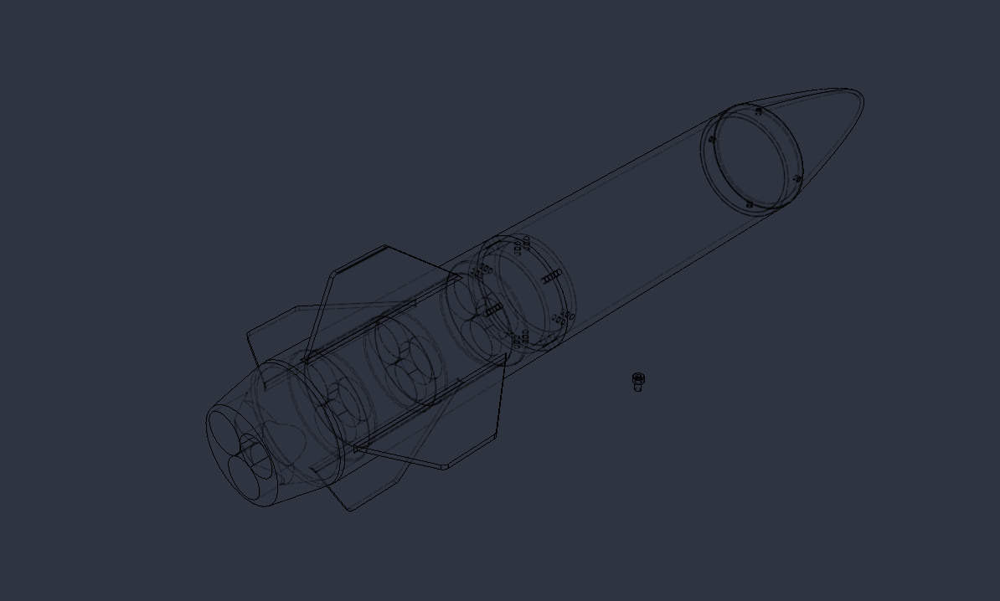
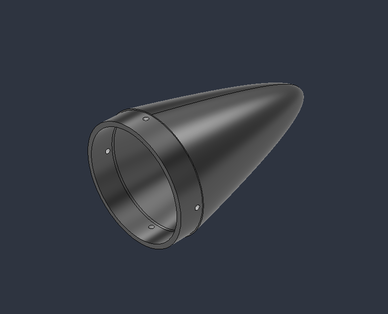
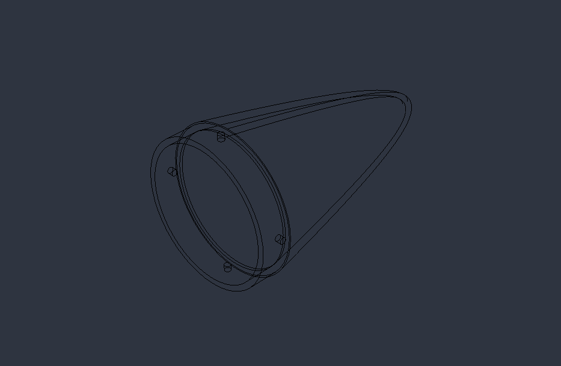
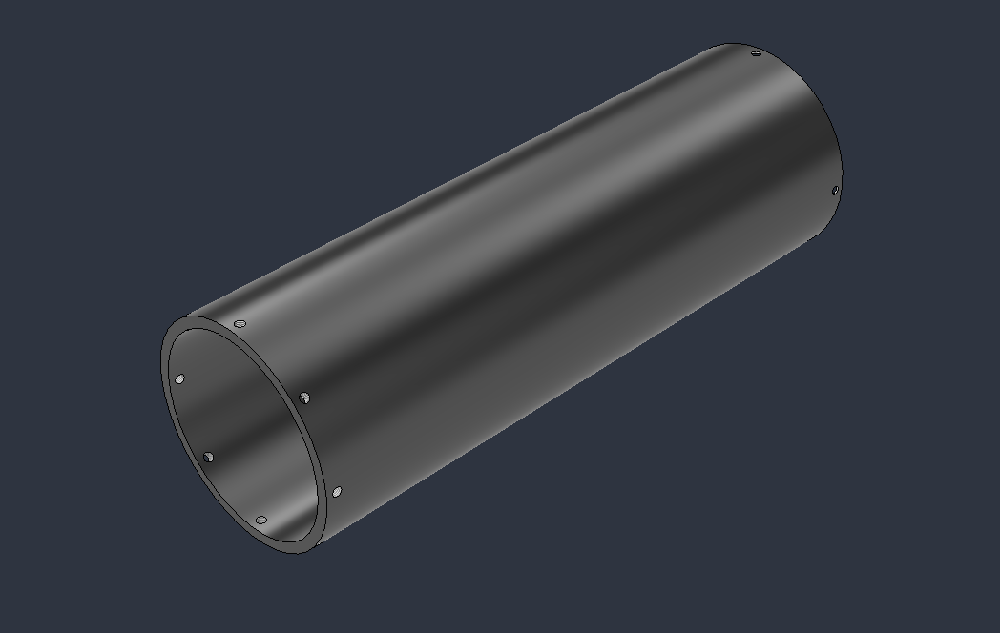
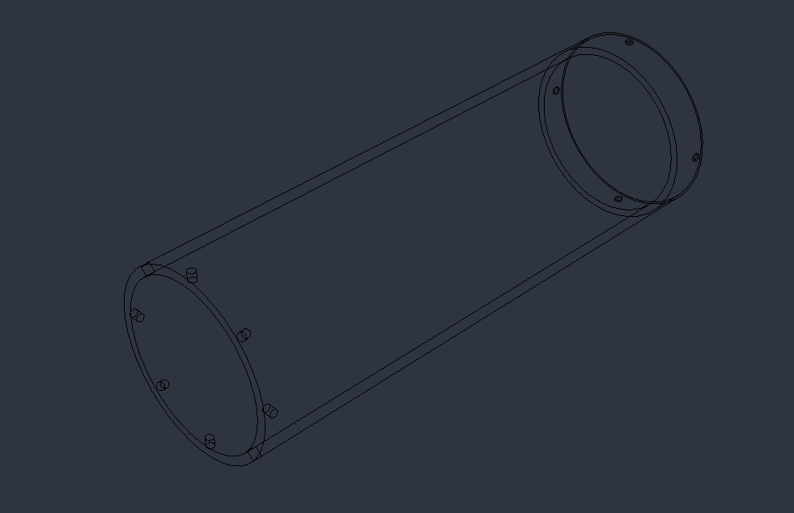
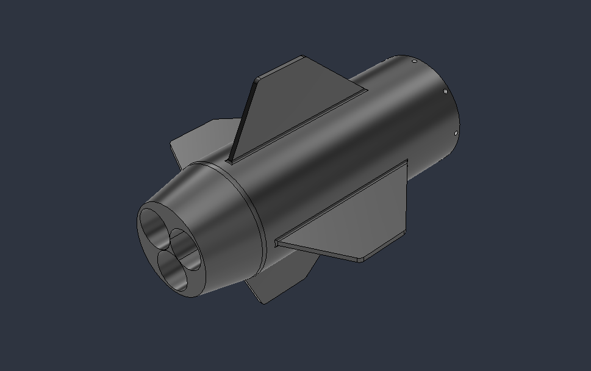
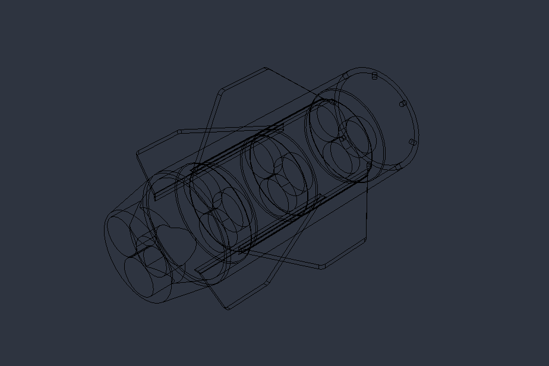
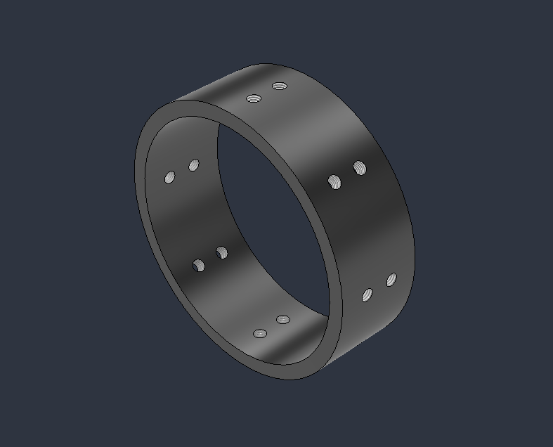
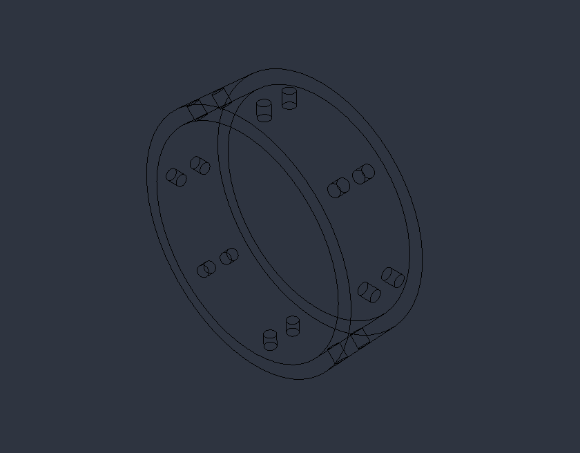

# inertia

This is the Repo for my first Rocket design and possibly also for future EX rocketry projects. This particular model is only a design prototype not a finished design.

# What is this

Inertia is my first attempt of creating a rocket design. I played around in Fusion360 essentially and designed this rocket with a handful of cool features I wanted to "challange" myself with.

The rocket features 4 parts and can be assembled with a total of 20 m5 screws of approx. 15mm lenght. Aft section, center section, coupler, nose cone.

Some things that are being tested with this design is the suitability of 3D printed parts for this particular low thrust rocket. 

# Project status

The project is in a publishable and testable state. There will probably come some more features or so called modules for the rocket.

# Motivation

This project was made for the half life by Hackclub project, and shipped there as main purpose. The other motivation for the project was, that i wanted to start building rockets after I informed myself now for quite some time. This seemed to be the perfect opportunity to finally start working on the project.

# Project journaling

Via the [Half life](https://halflife.hackclub.com) by Hackclub programm, several Journal entries have been made either in timelaps form or as written entry to track the project.

# Assembly

A expoded view, as well as a assembly and corresponding drawing are pending right now. The Rocket itself is build with 4 parts and 20 m5 screws. The parts are 3D printed with optionally PLA or PETG filament.

# Components

Nosecone:
The nosecone is Elipsoid shaped wich is deemed by several experts and "veterans" of the scene, as the optimal shape. Although in sub mach 0.5 speeds, these considerations are not that important, I still added them for testing.

wireframe

Center part: 
The center part has space to hold a payload or a recovery system, but also has enough space still to hold all avionics. In future there will be specific center part variations to serve each payload purpose needed.

wireframe

Aft and motor section: 
The Aft and motor section has several interesting features. There are 3 motor slots to fit in 3 category G motors. The module also has 4 trapezoidal fins for stability and the ensuerement of a 0 Angle of attack and maximum stability.

wireframe

Coupler:
To ensure that no bending loads during ascend can damage the rocket a coupler is used to connect the two bigger and therefore heavier parts together.

wireframe

Boattail: 
A fun extension for the rocket connected to the motor section and aiming to reduce the drag of the rocket. This unfortunately results in less stability.
