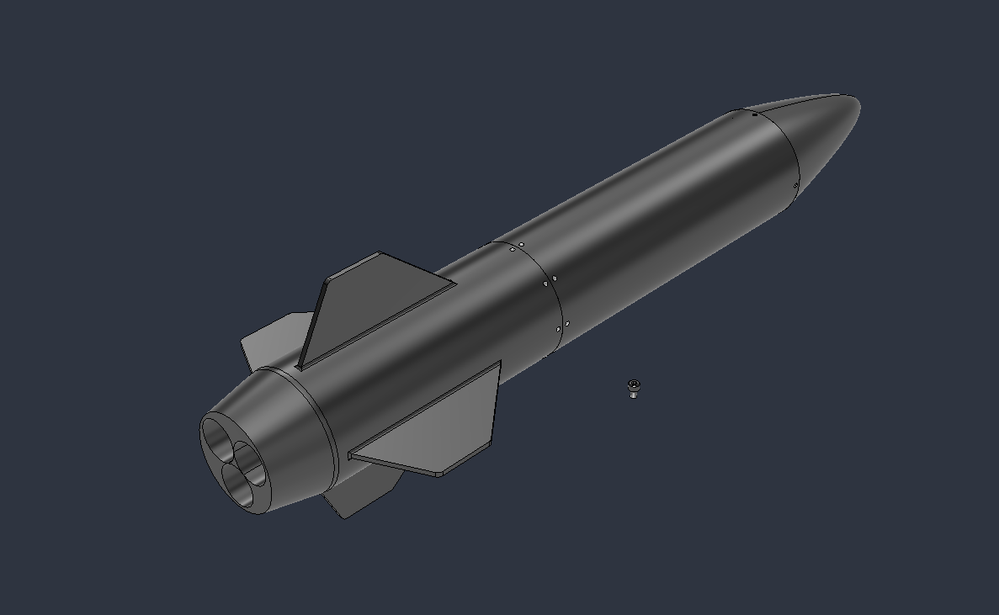
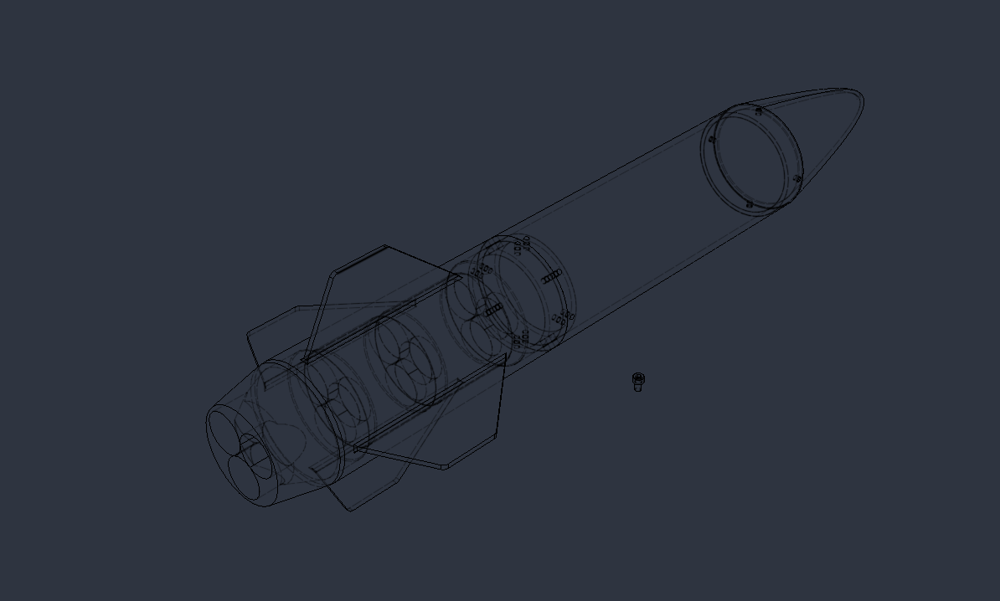
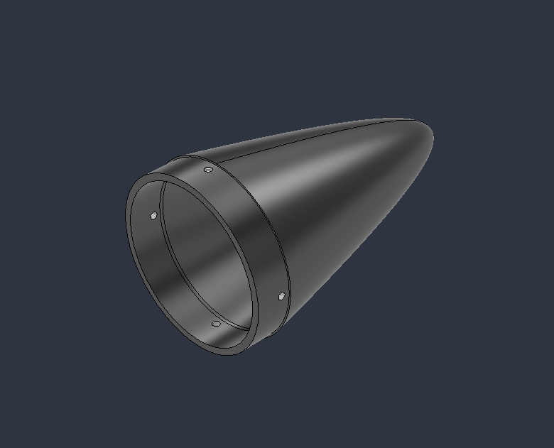
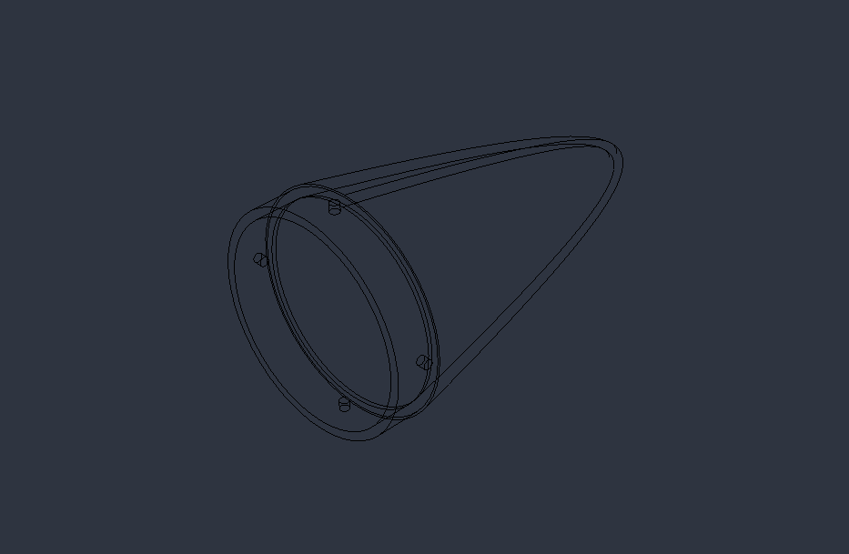
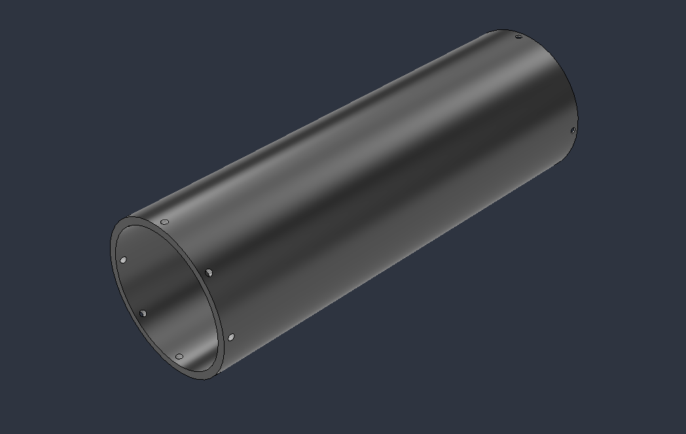
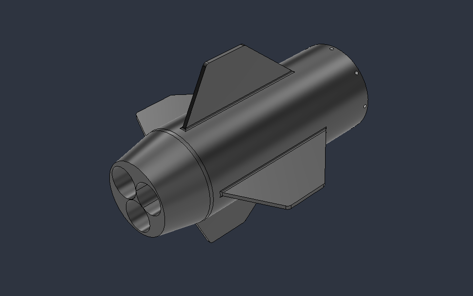
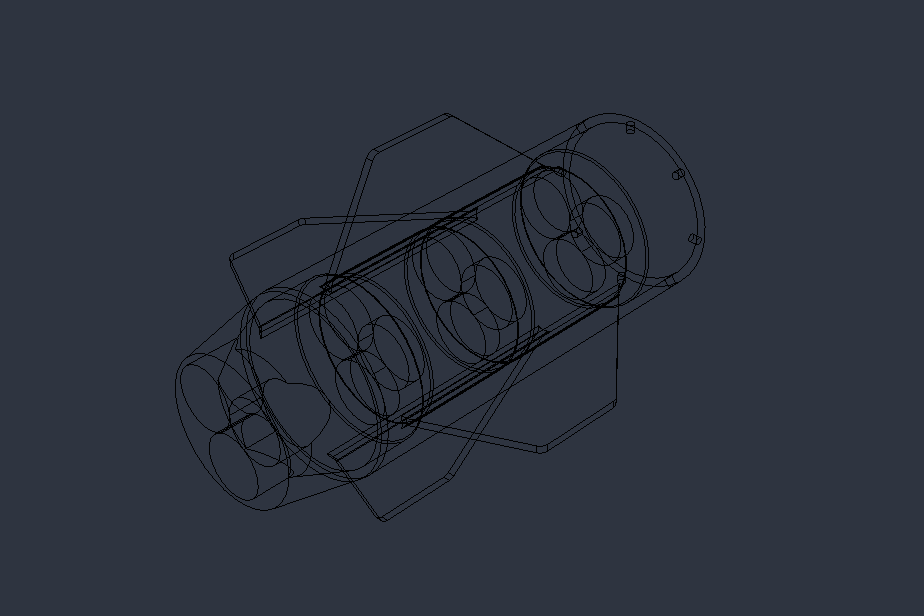
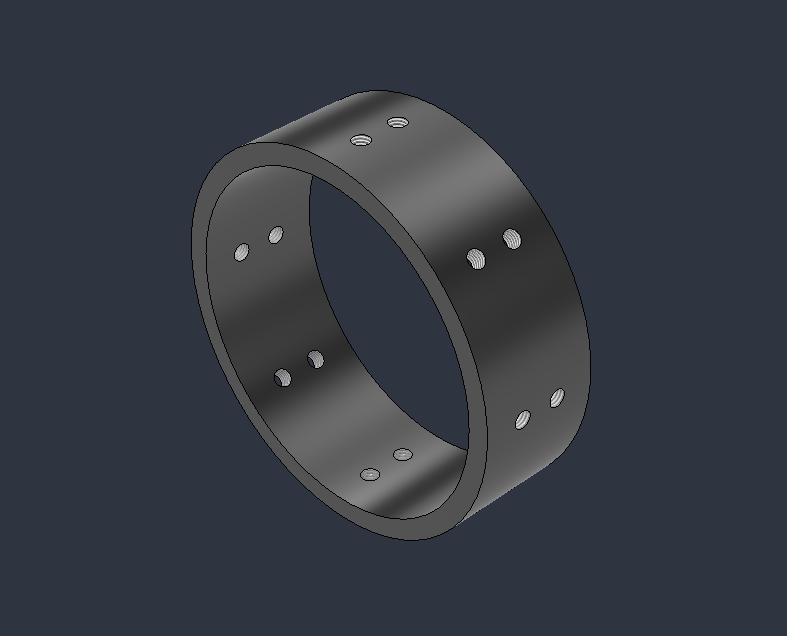
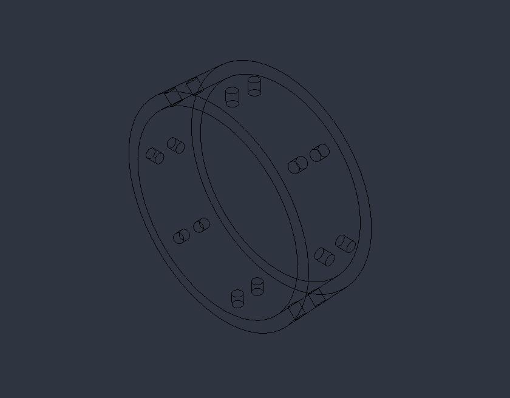

<p align="center"></p>

<p align="center">
  
  
  
  
</p>
<hr>
<h1 align="center">Inertia</h1>

<p align="center"></p>

> [!NOTE]
> This is the repo for my first rocket design and possibly for future experimental rocketry projects. This model is a design prototype, not a finished design.

## Table of contents

- [What is this](#what-is-this)
- [Specifications](#specifications)
- [Components](#components)
- [Assembly](#assembly)
- [Print settings](#print-settings)
- [Bill of materials](#bill-of-materials)
- [Safety](#safety)
- [Roadmap](#roadmap)
- [Repository structure](#repository-structure)
- [Project journal](#project-journal)
- [Motivation](#motivation)
- [Built with](#built-with)
- [License](#license)

## What is this

<p align="center"></p>

Inertia is my first attempt at designing a rocket. I designed it in Fusion 360 and added a handful of features I wanted to challenge myself with.

The rocket consists of **4 parts**: aft section, center section, coupler and nose cone. They are joined with [**20 × M5 screws** (approx. 15 mm long)].

- One of the things this design tests is whether 3D-printed parts are suitable for a low-thrust rocket like this one.

## Specifications

| Parameter | Value |
|-----------|-------|
| Length | … mm (pending...) |
| Body diameter | … mm (pending...) |
| Dry mass (without motors and avionics) | … g (pending...) |
| Motor configuration | 3 × G-class (cluster) |
| Fins | 4 × trapezoidal |
| Nose cone profile | Ellipsoid |
| Estimated apogee | … m (pending...) |
| Material | PLA or PETG and carbon steel (screws) |

## Components

<table>
  <tr>
    <th colspan="2">Nosecone</th>
  </tr>
  <tr>
    <td align="center" width="50%"><br><sub>Render</sub></td>
    <td align="center" width="50%"><br><sub>Wireframe</sub></td>
  </tr>
  <tr>
    <td colspan="2">The nosecone has an ellipsoid profile, which many experienced rocketeers consider a very good choice. At speeds below Mach 0.5 the shape matters little aerodynamically, but I included it for testing.</td>
  </tr>
</table>

<table>
  <tr>
    <th colspan="2">Center section</th>
  </tr>
  <tr>
    <td align="center" width="50%"><br><sub>Render</sub></td>
    <td align="center" width="50%"><br><sub>Wireframe</sub></td>
  </tr>
  <tr>
    <td colspan="2">The center section has room for a payload or a recovery system, plus enough space for all avionics. In the future there will be dedicated center section variants for different payload purposes.</td>
  </tr>
</table>

<table>
  <tr>
    <th colspan="2">Aft &amp; motor section</th>
  </tr>
  <tr>
    <td align="center" width="50%"><br><sub>Render</sub></td>
    <td align="center" width="50%"><br><sub>Wireframe</sub></td>
  </tr>
  <tr>
    <td colspan="2">The aft section holds <b>3 motor slots</b> for G-class motors and carries <b>4 trapezoidal fins</b>, which keep the angle of attack near zero and maximise stability.</td>
  </tr>
</table>

<table>
  <tr>
    <th colspan="2">Coupler</th>
  </tr>
  <tr>
    <td align="center" width="50%"><br><sub>Render</sub></td>
    <td align="center" width="50%"><br><sub>Wireframe</sub></td>
  </tr>
  <tr>
    <td colspan="2">The coupler joins the two larger, heavier sections so that bending loads during ascent can't damage the rocket.</td>
  </tr>
</table>

<table>
  <tr>
    <th>Boattail (optional)</th>
  </tr>
  <tr>
    <td align="center"><sub>Render pending</sub></td>
  </tr>
  <tr>
    <td>An optional extension attached to the motor section that reduces drag. The trade-off is reduced stability.</td>
  </tr>
</table>

## Assembly

1. Print all parts (see [Print settings](#print-settings)).
2. Join the aft section and center section with the coupler.
3. Attach the nose cone to the center section.
4. Secure all joints with the M5 screws (20 in total).

> [!NOTE]
> An exploded view, assembly drawing and technical drawing are still pending.
>
> There will come a video or an image tutorial of some sorts. But I did not build the rocket myself yet.

## Print settings

| Part | Material | Layer height | Infill | Walls | Supports |
|------|----------|-------------:|-------:|------:|:--------:|
| Nosecone | PLA / PETG | … mm | … % | … | … |
| Center section | PLA / PETG | … mm | … % | … | … |
| Aft section | PETG recommended | … mm | … % | … | … |
| Coupler | PLA / PETG | … mm | … % | … | … |
| Boattail | PLA / PETG | … mm | … % | … | … |

**Printer requirement:** build plate of at least **180 × 180 mm**.
all parameters: (pending...)

## Bill of materials

| Item | Qty | Supplier | Cost/item | Total Cost | Link |
|------|----:|----------|----------:|-----------:|------|
| PLA filament (1 kg) | 1 | Polymaker | $19.99 | $19.99 | [Polymaker](https://shop.polymaker.com/products/polylite-pla) |
| M3 screws (pack/various lengths) | 1 | Amazon | $10.00 | $10.00 | [Amazon](https://www.amazon.de/dp/B0CY1ZR8XS) |
| G-class motors | 3 | … | … | … | … |
| Recovery parachute | 1 | … | … | … | … | <- (pending...)
| Estimated total shipping | 1 | | | $0.00 | |
| **Total (excl. motors & recovery)** | | | | **$29.99** | |

## Safety

> [!WARNING]
> - Motor classes and launch rules are regulated differently in every country. **Check your local laws** before buying motors or flying – G-class motors often require certification or a permit.
> - PLA softens at around 55–60 °C. Make sure the motor mounts are protected against heat (motor tubes, heat-resistant liner, or PETG/ASA for the aft section). <- no self testing conducted (handle with care!)
> - Clustered motors must ignite simultaneously. An uneven ignition can lead to an unstable flight.
> - Always simulate the design (e.g. in OpenRocket) and confirm a positive stability margin before flying.
> - Follow the safety code of your national rocketry association and only fly at approved launch sites.

## Roadmap

- [x] Initial airframe design
- [x] Printable parts
- [ ] Exploded view & assembly drawing
- [ ] Initial build and validation
- [ ] OpenRocket simulation (`.ork` file + stability plot)
- [ ] Recovery system design
- [ ] Payload / avionics center-section variants
- [ ] First test flight
- [ ] Parameter updating and trouble shooting  

## Repository structure

```
inertia/
├── Images/        # Renders, wireframes and logo
├── CAD/           # Fusion 360 / STEP source files
├── STL/           # Print-ready files (slice ready)
├── JOURNAL.md     # Build journal
├── LICENSE        # No licence at the moment!
└── README.md
```

## Project journal

As part of the [Half Life](https://halflife.hackclub.com) program by Hack Club, I tracked the project with journal entries, either as timelapses or as written entries. You can find them in [JOURNAL.md](JOURNAL.md).

## Motivation

I made this project for Hack Club's Half Life program, where it was shipped. I also wanted to start building rockets after reading up on the topic for quite some time, and this seemed like the perfect opportunity to finally begin.

## Built with

- Autodesk Fusion 360
- Prusa MK4

## License

This project has no License at the moment.
This project is licensed under the terms in [LICENSE](LICENSE).
